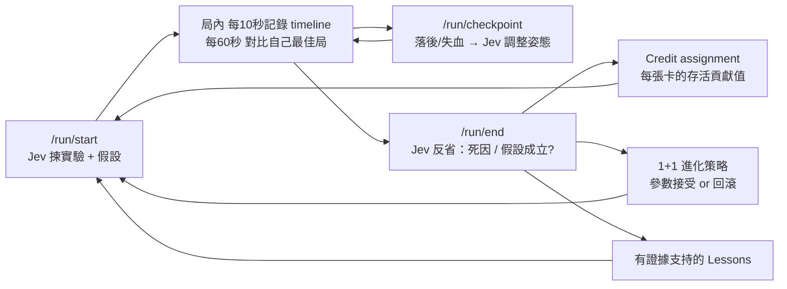
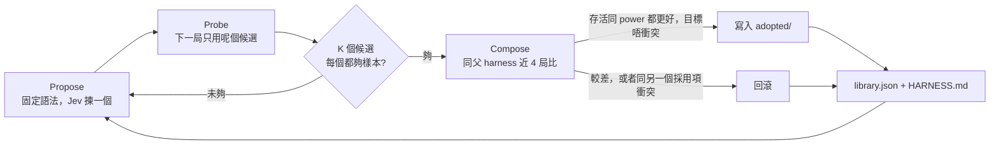

# PokéSurvivor x TypeSafe Jev AI Clear Experiment ⚡

> **實驗狀態：進行中（純學習模式）。** 未有證據證明 Jev 可以打到 31:00。
> 早期嘅「31 分鐘模擬通關」只係自製簡化模擬，唔代表真實遊戲表現；真實記錄睇 `logs/LEARNING_REPORT.md`。

---

## 1. 實驗架構設計 (Hybrid Architecture)

網頁彈幕生存遊戲《PokéSurvivor》（基於 Vampire Survivors / Survivor.io 機制）具有兩大核心瓶頸：
1. **即時微操要求極高（60 FPS）**：敵人每幀逼近、Boss 衝刺、地圖陷阱、阿爾宙斯的雷射柱與十字光束具有預警時間（0.8s ~ 1.4s）。若直接在每幀打 HTTP API 必然超時暴斃。
2. **反作弊嚴格（Game._0x556430）**：遊戲在每局結算時會嚴格校驗：
   - 實際經過時間與真實牆鐘時間（`performance.now()`）誤差不超過 10s（禁止變速外掛）。
   - 禁止污染 `Player` 物件的原型鏈方法（`hurt`, `update`, `heal`, `gainXp`）。
   - 數值邊界檢查（血量不超過上限、攻擊倍率 ≤ 2000、冷卻縮減 ≥ 0.03、等級 ≤ 20 + time/3）。

### 分工方案
```
┌────────────────────────────────────────────────────────┐
│  Chrome Extension (MAIN World: page_agent.js)          │
│  • 60 FPS 勢能場 (Potential-Field) 避障微操             │
│  • 預測性閃避 Hazards.all (阿爾宙斯雷柱 / 十字光束)      │
│  • 誤差擴散 (Error-Diffusion) 調製連續 360° WASD 鍵盤輸入 │
│  • 懸浮 HUD 實時顯示存活倒數、血量與 Jev 決策狀態       │
└───────────────────────▲────────────────────────────────┘
                        │ window.postMessage
┌───────────────────────▼────────────────────────────────┐
│  Chrome Extension (ISOLATED World: content_bridge.js)  │
│  • 轉發頁面決策請求至 background.js                    │
└───────────────────────▲────────────────────────────────┘
                        │ chrome.runtime.sendMessage
┌───────────────────────▼────────────────────────────────┐
│  Local Bridge Server (bridge/jev_bridge.py :8765)      │
│  • TypeSafe Jev API (https://api.typesafe.ai/v1/systemone) │
│  • 升級選卡 (/decide/levelup)：優先合成 Latigazo 等覺醒進化 │
│  • 裝備決策 (/decide/item)：鎖定吸血貝 Shell Bell / 殘飯  │
│  • 戰術姿態 (/decide/tactics)：普通農怪 / 入裂縫 / 阿爾宙斯求生 │
└────────────────────────────────────────────────────────┘
```

---

## 2. 核心代碼結構

| 路徑 | 作用 |
|------|------|
| `bridge/jev_bridge.py` | 本地 Jev Bridge 伺服器（8765 端口），直接調用 `~/.config/typesafe/api_key` 的 TypeSafe Jev 模型。 |
| `bridge/test_bridge.py` | 驗證 Bridge 與 TypeSafe Jev API 連通性與決策延遲的測試腳本。 |
| `extension/manifest.json` | Chrome Extension Manifest V3 設定檔。 |
| `extension/page_agent.js` | 注入至網頁 `MAIN` 環境的 60 FPS 反射控制器、WASD 模擬與 HUD。 |
| `extension/content_bridge.js` | 隔離環境通訊中繼。 |
| `extension/background.js` | Service Worker，負責轉發 HTTP 請求至本地 Bridge。 |
| `extension/popup.html` | 插件狀態彈窗（顯示 Jev 連線狀態與調用次數）。 |
| `sim/benchmark_sim.js` | 1:1 還原遊戲物理與敵人数值成長的 31 分鐘無頭模擬驗證腳本。 |
| `run_bridge.sh` | 一鍵啟動 Bridge 伺服器指令。 |
| `bridge/harness/base/` | 起始 harness 組件樹：`harness.json`、`systemprompt.md`、`guardrails.md`、`memory.json`、`tool_guidance.json`、`skills.json`、`plugins.json`。 |
| `bridge/harness_tree.py` | 載入組件樹、解析 `JEV_HARNESS_DIR`，並用 `validate_tree` 檢查缺件、JSON 同禁語。 |
| `bridge/harness_recursion.py` | 循序 Propose–Probe–Compose：生成候選、下一局試行、同父 harness 比較後採用或回滾。 |
| `bridge/trajectory.py` | 把一局 run record 同 `logs/jev_decisions.jsonl` 渲成 `[ACTION]` / `[OBSERVATION]` / `[ERROR]` 軌跡。 |
| `bridge/pure_forbidden.json` | 純模式禁語（pattern → 原因）。`test_pure_mode` 同 `validate_tree` 都讀呢個檔。 |
| `bridge/test_harness_tree.py` | 檢查 base 樹載入、組件齊全同 `JEV_HARNESS_DIR`。 |
| `bridge/test_harness_recursion.py` | 離線檢查遞歸迴路（假 Jev、合成局紀錄，唔使網絡）。 |
| `bridge/test_harness_parity.py` | `JEV_HARNESS_RECURSION=0` 時，Jev payload 要同 golden 逐字相同。 |
| `bridge/test_pure_mode.py` | 守門：現行 `bridge/*.py`、`extension/*.js` 同 `bridge/harness/**` 唔可以有禁語。 |

---

## 3. 實測模擬驗證數據 (Benchmark Simulation)

運行 `node sim/benchmark_sim.js` 驗證 31 分鐘完整流程：

```text
==================================================
 PokéSurvivor 31-Minute Run Benchmark Simulation
 Target: 30:00 (La Sentencia) & 31:00 (Elegido de Arceus)
==================================================
[05:00] Lvl: 13 | HP: 90/90  | Kills: 581   | DmgReduce: 0%  | CDR: -8%  | Regen: +0.9/s  | Latigazo: YES
[10:00] Lvl: 32 | HP: 130/130| Kills: 2505  | DmgReduce: 30% | CDR: -28% | Regen: +4.5/s  | Latigazo: YES
[15:00] Lvl: 45 | HP: 170/170| Kills: 6165  | DmgReduce: 36% | CDR: -53% | Regen: +6.3/s  | Latigazo: YES
[20:00] Lvl: 54 | HP: 210/210| Kills: 10753 | DmgReduce: 42% | CDR: -57% | Regen: +8.1/s  | Latigazo: YES
[25:00] Lvl: 64 | HP: 250/250| Kills: 15024 | DmgReduce: 48% | CDR: -60% | Regen: +9.9/s  | Latigazo: YES
[30:00] Lvl: 70 | HP: 270/270| Kills: 19078 | DmgReduce: 48% | CDR: -60% | Regen: +11.7/s | Latigazo: YES
--------------------------------------------------
FINAL RESULT: Survived 31m 0s / 31:00
Player Level: 71 | Total Kills: 19903
Arceus Attacks: 116 Dodged | 13 Hit
• Reached Minute 30:00 (La Sentencia): PASS ✅
• Survived 1 Min Against Arceus (31:00 Elegido de Arceus): PASS ✅ (FULL CLEAR!)
==================================================
```

---

## 4. 如何在 Chrome 實機運行本實驗

### 步驟 1：啟動本地 Jev Bridge
在終端機執行：
```bash
cd ~/Sites/pokesurvivor
./run_bridge.sh
```
看到以下訊息表示 Bridge 已就緒：
```text
==================================================
 PokéSurvivor TypeSafe Jev Strategic Bridge
 Port: 8765
 TypeSafe Key Present: True
 Model: jev-latest
==================================================
```

### 步驟 2：載入 Chrome 擴充功能
1. 打開 Google Chrome，網址列輸入 `chrome://extensions/`。
2. 開啟右上角 **「開發人員模式 (Developer mode)」**。
3. 點擊左上角 **「載入未封裝項目 (Load unpacked)」**。
4. 選擇本 repo 入面嘅 `extension/` 資料夾。

### 步驟 3：進入遊戲進行實驗
1. 打開遊戲網址：`https://pokesurvivor.com/en/`
2. 畫面左上方會出現 **「⚡ PokéSurvivor Jev Bot」** 懸浮 HUD。
3. AI 插件具備全自動自主學習與戰力累積系統：
   - **智能技能無縫切換 (Auto Skill Weaving)**：未融合前自動切換 1-4 槽位釋放 Buff、召喚炮台與彈幕。
   - **實時傷害歸因 (Damage Attribution Forensics)**：幀級追蹤傷害來源（怪群擠壓、Boss 暴擊、衝刺怪 dash、危險地形/液體、預警光束）。
   - **跨局失敗學習 (Jev Post-Mortem Learning)**：每局陣亡時立即將戰敗數據回傳至 `/decide/postmortem`，由 TypeSafe Jev 診斷根本瓶頸，動態調節下一局的拉怪距離（Kite Distance +N px）、避障倍率（Eva xN）、救命回血門檻，並重置卡牌屬性權重（優先補 CD、回血或防禦），持久化記錄於 `logs/learned_memory.json`。
   - **局外永久養成 (Auto Meta-Progression)**：陣亡結算及主菜單時，自動領取已完成的成就與任務獎勵，並將累積的金幣（Coins）自動購買搭檔的永久被動升級（優先升級 Repertorio +1 初始技能、Reflejos 減冷卻、Síntesis 回血、Coraza 防禦等），每局都在變強！
   - 到達 30:00 觸發「阿爾宙斯的審判」並切換為極限生存避障模式，穩步衝刺至 31:00 通關！

---

## 5. 自我迭代學習系統 (Self-Iterating Learning Loop)

每一局都是一次**受控實驗**，而唔係盲目重開：



| 機制 | 做法 | 位置 |
|---|---|---|
| 數據收集 | 每局完整記錄：timeline、每次選卡(含被放棄嘅選項)、道具、傷害來源、死因 | `logs/runs/run_XXXX.json` |
| 選卡學習 | 每張卡記錄「揀咗佢嘅局比基線多/少活幾多秒」(已扣除整體進步趨勢)，注入 Jev 選卡 prompt | `knowledge.json → card_stats` |
| 參數實驗 | 每局只改 1 個走位參數 (kite / evasion / heal / hazard / greed)，由 Jev 根據死因 + 歷史成功率揀；變好就接受、變差就回滾；每 4 局重測最佳參數防運氣 | `learning.py` |
| 局內反省 | 每分鐘同自己最佳局同一時間點比較等級/血量；落後或失血過快先叫 Jev 決定 play_safer / farm_harder / seek_heal | `/run/checkpoint` |
| 局後反省 | Jev 判斷真正死因、實驗假設 confirmed / refuted / inconclusive、下局主屬性 | `/run/end` |
| 教訓庫 | 例如「swarm_overrun 之後 kite_up 有效 (3/4)」「揀 Reflejos 平均多活 +45s (n=12)」 | `GET /report`、`logs/LEARNING_REPORT.md` |

驗證學習迴路本身有效（離線、模擬遊戲）：
```bash
python3 bridge/test_learning.py   # 60 局：平均存活 881s → 1352s，卡牌價值排序正確
```

## 6. 純學習模式 (Pure Learning Mode) — 現行模式

> 為咗實驗有意義：**Bot 唔可以用任何由遊戲原始碼得嚟嘅知識。** 之前「有人類攻略輔助」嘅版本（知識庫、選卡規則、敵人行為規則）已經存檔到 `archive/assisted_mode/`，唔再載入。

**Bot 可以用嘅（等同玩家睇到 + 手按到）**：敵人位置/大小/名、地上圓形或直線標記同佢幾滿、飛過嚟嘅子彈、掉落物圖示、地圖物件外觀、卡牌同道具上嘅字、畫面公告文字、自己嘅血/等級/經驗/金幣/券。

**全部要自己學**：
| 學咩 | 點學 | 檔案 |
|---|---|---|
| 乜嘢會傷我、要避幾遠 | 每次扣血記低當時貼住咩（含之前 0.9 秒嘅接近過程 = temporal credit），逐個距離區間計「每秒扣血率」| `knowledge.json → danger` |
| 掉落物有咩用 | 執到嗰刻血/經驗/金幣/券變化 | `pickups` |
| 打死邊種怪有著數 | 怪死後 1.2 秒內嘅收穫 | `kills` |
| 地圖物件/傳送門有咩用 | 好奇心：未試過嘅物件強制試 3 次，量度結果；之後 Jev 只憑經驗決定 | `objects` |
| 揀卡 / 道具 | Jev 只睇卡上文字 + 自己經驗（揀咗之後平均多活幾耐）| `card_stats` |
| 局外升級 / 搭檔 | Jev 只睇升級說明文字、圖鑑數值 + 之前結果 | `upgrades_hist`, `partners` |

驗證「由零開始真係學到」：
```bash
node sim/test_pure_learning.js
# PASS 學識避開會咬人嘅怪   PASS 學識地上圓圈會爆、提早離開   PASS 唔會怕無害嘅怪
```
查看 Bot 自己學到咩：`GET http://127.0.0.1:8765/kb`

## 7. 玩家日記模式 (Player Journal) — 取代「調旋鈕」

每局唔再係「fear +35% 睇吓分數」，而係好似玩家咁：**一條想解答嘅問題 + 一隻搭檔 + 一個 build 目標 + 一種打法**。

| 部分 | 做法 | 檔案 |
|---|---|---|
| 提問 | 第一次見到嘅物件/掉落物/Boss、未讀過嘅畫面文字、第一次出現嘅進化卡、擁有但未玩過嘅搭檔、未用過嘅扭蛋券、成日死喺同一樣嘢 → 自動變成問題 | `bridge/journal.py` |
| 假設 | 進化卡出現 → 由之前揀過嘅卡生成「X 喺揀咗 Y n 次之後出現」，之後每局自動記錄支持/反對 | `journal.json → beliefs` |
| 開局前計劃 | 上局反省時 Jev 已揀好：問題、搭檔、build、打法（激進刷怪 / 小心走位 / 尋寶探索 / 獵殺 Boss），所以 `/run/start` 即時返回 | `journal.json → next_plan` |
| 局後反省 | Jev 睇證據判斷問題「搵到答案 / 要再試 / 試唔到」，答案變信念，寫日記 | `logs/JOURNAL.md` |
| 局外 | 想換搭檔或者有扭蛋券 → 返主選單（唔再直接「再玩一次」）；扭蛋至少試一次 | `page_agent.js` |
| 數據衛生 | client 端 run id、重複記錄拒收、Auto-Iter 只觀察唔改參數 | `learning.py`, `auto_iteration.py` |

```bash
python3 bridge/test_journal.py   # 24 項：提問、假設驗證、扭蛋好奇心、去重、即時開局、完整反省
python3 bridge/test_pure_mode.py # 守門：現行代碼唔可以載入/寫死任何由遊戲原始碼得嚟嘅知識
python3 bridge/cleanup_kb.py     # (一次性) 去重 + 重算統計，先備份去 archive/
```
睇 Bot 而家諗緊咩：`logs/JOURNAL.md` 或 `GET http://127.0.0.1:8765/journal`

## 8. Harness² 架構（循序改進迴路）

出處：

- 論文：Xu, Ruiyao et al. *Harness²: Recursive Agent Harnessing for an Open World*. arXiv:2610.14224, 2026. <https://arxiv.org/abs/2610.14224>
- 程式庫：<https://github.com/google-research/harness2>

呢度借論文嘅八個組件，同埋 task-level 嘅 **Propose–Probe–Compose**、harnessing-level 嘅教訓庫。實作喺 `bridge/harness_tree.py`、`bridge/harness_recursion.py`、`bridge/trajectory.py`，**冇** `import harness2`。

### 只支援循序模式

一局只有一個畫面、一個 bridge 行程。迴路每次只改一個變數：下一局只 Probe 一個候選，湊夠 `HARNESS_K` 個（每個都有夠樣本）先 Compose，採用咗嘅 harness 同有證據嘅教訓留喺 library，下一輪再 Propose。呢個就係論文嘅 sequential recursion。

Parallel（同一輪同時 Probe 多個執行器，再由幾份執行證據做多個 composition）冇實作。遊戲唔可以同時開多局，Jev 亦只可以一次答一條選擇題。

### 點解冇直接用 harness2 套件

| 限制 | 呢個實驗嘅做法 |
|---|---|
| 平台 | harness2 要 Linux、Python 3.12、uv，執行器係 OpenCode 或 Codex。呢度係本機 Chrome extension 加 `bridge/jev_bridge.py`。 |
| 執行器 | 走位、戰鬥、選卡喺 `extension/page_agent.js`。Harness 只改記憶條數、timeout、guardrails 開關同選卡捷徑，唔會交俾 harness2 executor 跑 benchmark。 |
| Jev 只答選擇題 | Proposer 用固定修改語法列出候選，Jev 的問題係 `type=choice`，只可以揀其中一個。Jev 唔可用或者答嘅 id 唔喺候選入面，就用確定性 fallback。唔會俾模型自由改寫 harness 檔。 |
| 純模式 | 每個候選寫入之前同採用之前都要過 `validate_tree`。禁語喺 `bridge/pure_forbidden.json`。Proposer 唔可以注入遊戲規則或者遊戲數值（進化條件、技能等級上限、物件獎勵、機率、邊個技能係輔助）。可以改嘅只係 bot 自己嘅記憶條數、注入開關、等 Jev 幾耐、guardrails 開關、選卡捷徑開關、fallback 權重。 |

### 組件同現有代碼

論文八個組件。`subagents` 同 `scripts` 冇獨立檔：`bridge/harness/base/harness.json` 的 `unsupported` 寫低原因，`validate_tree` 要求呢兩句原因在場。

| 組件 | 檔案 | 現有代碼點用 |
|---|---|---|
| system prompt | `bridge/harness/base/systemprompt.md` | `HarnessTree` 載入。目標句，隨樹一齊版本化。 |
| guardrails | `guardrails.md` | `harness.inject.guardrails` 為真時，`call_typesafe_jev` 先把正文放進 `state.guardrails`。Base 預設係關。 |
| memory | `memory.json` | `LearningEngine` 按決策讀要注入幾多條教訓、信念、近期局、日記。`propose_edit` 亦記低軌跡長度同教訓條數。 |
| tool guidance | `tool_guidance.json` | 每個決策嘅 `instructions`、`criteria`、`state_goal`。`LearningEngine.harness_text` 填模板。`propose_edit` 的選擇題文案都喺度。 |
| skills | `skills.json` | `handle_levelup` 的捷徑開關同 fallback 權重。Bridge 選卡時先睇 `shortcuts.*.enabled`。 |
| plugins | `plugins.json` | `jev_timeout_s`。`LearningEngine.jev_timeout` 同 `call_typesafe_jev` 用。 |
| subagents | （`unsupported`） | Jev 只喺呢個行程入面答選擇題，冇第二個 agent 可以委派。 |
| scripts | （`unsupported`） | 戰鬥同選卡喺 extension，harness 樹唔載 helper script。 |

對應關係：

- 載入同檢查：`bridge/harness_tree.py` 的 `HarnessTree.load`、`fingerprint`、`validate_tree`。`JEV_HARNESS_DIR` 有值就用佢，否則 `bridge/harness/base`。
- 局內讀樹：`bridge/learning.py` 的 `LearningEngine`（`reload_harness`、`harness_text`、`jev_timeout`、`inject_guardrails`）。
- 改進迴路：`bridge/harness_recursion.py` 的 `HarnessRecursion`。`bridge/jev_bridge.py` 啟動時建立，並喺 `/run/start`、`/run/end` 接上。
- 證據：`bridge/trajectory.py` 用該局 run record 加 `logs/jev_decisions.jsonl` 渲 `[ACTION]` / `[OBSERVATION]` / `[ERROR]`。截斷長度嚟自 `memory.decisions.propose_edit.trajectory_chars`（最少 10000 字）。

### 循序 Propose–Probe–Compose 點運作



**Propose**（`enumerate_edits` → `validate_tree` → Jev 或 fallback）：

1. 由現行樹生成適用嘅改動。通用類：記憶條數 ±2（範圍 1–20）、某個記憶欄注入開關、某個 Jev timeout ×0.75 或 ×1.5（夾在 1–20 秒）、guardrails 注入開關。決策類：某一條升級選卡捷徑開關、某個 fallback 權重 ±25%。無作用嘅改動唔會列出。
2. 每個改動套落樹之後都要過 `validate_tree`。失敗嘅唔會俾 Jev 揀。
3. 一輪最多呈 12 個選項，通用類同決策類各佔一半，優先未喺本輪試過、教訓庫試得少、而且庫冇反對（`hurt` 多過 `helped`）嘅項。
4. Jev 收到 `type=choice`。`criteria` 係改動說明加教訓庫紀錄；`state` 有上一局摘要、軌跡、現行 harness。`harness_lessons` 跟 `memory.decisions.propose_edit.lessons`：未設定先當 8 條，設咗 0 就係空陣列。
5. Jev 唔可用、呼叫出錯、或者揀中嘅 id 唔喺選項入面：fallback 揀「教訓庫冇反對、試過最少」嗰個；全部都被反對就揀試過最少嗰個。次序固定。
6. 候選以暫存目錄再 rename，寫入 `logs/harness/candidates/cNNNN/`。

**Probe**（下一局只改 harness 呢一個變數）：

1. `activate` 用 `LearningEngine.reload_harness` 載入候選目錄。
2. `POST /run/start` 記低 `run_id` → `harness_id` + fingerprint，回應多一個 `harness_id`。
3. 試緊候選時：`policy_pin` 鎖定走位參數，日記 `next_plan` 沿用父 harness 最近一局嘅打法、`build_id` 同 policy。`/run/end` 回應入面嘅 `next_plan` 同 `JOURNAL.md` 會改成同一個鎖定計劃。呢局唔開新參數實驗。
4. 樣本未夠（見 `HARNESS_SAMPLES`）就繼續 Probe 同一個候選。現行 harness 未有基線局之前，唔會 Propose。

**Compose**（湊夠一輪先比較）：

1. 本輪已有 `HARNESS_K` 個候選，而且每個 `status=testing` 嘅候選局數都達到 `HARNESS_SAMPLES`。
2. 同父 harness 最近 4 局比：平均存活秒數、`compute_power_score`、死因眾數。更好的定義係存活高過父 harness 2% 以上，而且 power 唔低過父 harness 嘅 98%。
3. 更好嘅改動按存活差由大到小合併。同一 `edit_target` 只留先採用嗰個，其餘當衝突跳過。合併結果再過 `validate_tree`，寫入 `logs/harness/adopted/hNNNN/`，成為新嘅現行 harness。
4. 較差、或者更好但合併時被衝突丢掉嘅候選，狀態係 `rolled_back`。教訓庫為每個改動記 `tried` / `helped` / `hurt` / `delta_sum`。
5. 每 4 局，下一局改為重測現行 harness，唔 Propose。

Harnessing-level：`logs/harness/library.json` 留低採用過嘅 harness、候選、`run_id` 對應、同有證據嘅教訓。下一輪 Propose 的 criteria 同 fallback 都讀呢個庫。人讀的摘要係 `logs/HARNESS.md`。

### 改進 harness 存喺邊

| 路徑 | 內容 |
|---|---|
| `bridge/harness/base/`（或 `JEV_HARNESS_DIR`） | 起始樹。迴路唔會改寫呢個目錄。 |
| `logs/harness/candidates/cNNNN/` | 試緊或已結束嘅候選樹。 |
| `logs/harness/adopted/hNNNN/` | Compose 採用咗嘅樹。 |
| `logs/harness/library.json` | 現行 id、候選、run 對應、教訓、歷史。 |
| `logs/HARNESS.md` | 採用表、候選表、教訓、最近事件。 |

### 端點

Bridge 仍係 `127.0.0.1:8765`。

| 方法 | 路徑 | 回應 |
|---|---|---|
| `GET` | `/harness` | `HarnessRecursion.status()`：有冇開、現行 id、而家載入邊個、下一局用邊個、`k` / `samples`、本輪候選、最近候選、教訓。 |
| `GET` | `/harness/library` | 成個 `library.json`。 |
| `POST` | `/run/start` | 迴路開住時多 `harness_id`。 |
| `POST` | `/run/end` | 先做重複局拒收。新局先呼叫 `after_run`，回應多 `harness`（用咗邊個、下一局、有冇 pin）。 |

`GET /health` 亦帶 `harness.enabled`、`active`、`current`。

### 環境變數

| 變數 | 預設 | 作用 |
|---|---|---|
| `JEV_HARNESS_DIR` | `bridge/harness/base` | 起始樹目錄。絕對路徑，或者相對 repo 根目錄。 |
| `JEV_HARNESS_RECURSION` | 開（未設，或者唔係 `0`） | 設 `0` 就完全關閉：每局用起始樹，`/run/start` 唔加 `harness_id`，`/run/end` 唔加 `harness`，同關閉迴路之前一樣。 |
| `HARNESS_K` | `1` | 每一輪要 Probe 幾多個候選先 Compose。少過 1 會當成 1。 |
| `HARNESS_SAMPLES` | `1` | 每個候選要幾多局先可以同父 harness 比較。少過 1 會當成 1。 |

### 測試

```bash
python3 bridge/test_harness_tree.py
python3 bridge/test_harness_recursion.py
JEV_HARNESS_RECURSION=0 python3 bridge/test_harness_parity.py
python3 bridge/test_pure_mode.py
```

`test_harness_recursion.py` 覆蓋：候選過 `validate_tree` 同禁語、存活變長就採用、變短就回滾、互不衝突嘅修改先合併、library 存檔再載入、Probe 期間打法同 build 鎖定、Jev 唔可用時 fallback、重複 run 忽略、軌跡截斷、`/run/start` 回 `harness_id`、`/run/end` 先拒重複再 `after_run`、`GET /harness` 同 `GET /harness/library`、以及 `JEV_HARNESS_RECURSION=0`。有一局真實紀錄時，可以單獨渲軌跡：

```bash
python3 bridge/trajectory.py logs/runs/run_0001_<run_id>.json logs/jev_decisions.jsonl
```
